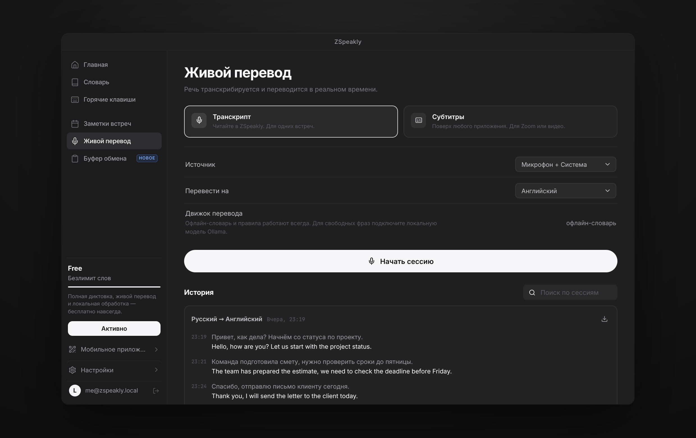
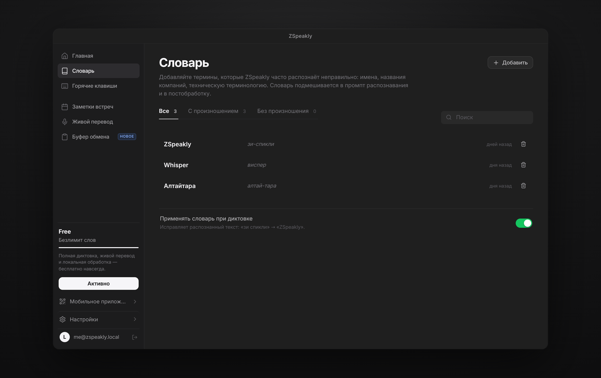
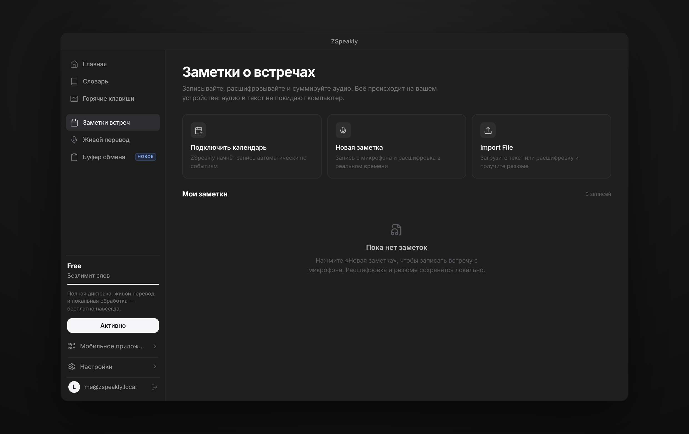
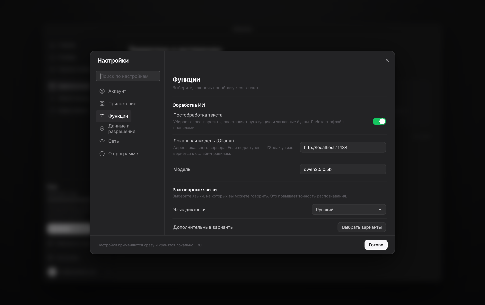

# ZSpeakly — не печатай, просто говори

> Бесплатный офлайн-клон Speakly: диктовка в любое поле, живой перевод, заметки встреч,
> словарь, история буфера обмена и AI-инструкции. Без облака, подписки и лимитов слов.

Собран по покадровому разбору видео `vsdc-sr 2026-10-22 23-13-29_compross.mp4` (6:49, 409 кадров →
32 состояния UI). Разбор, план и палитра лежат в [`docs/`](docs/).


---

## Что уже работает

| Раздел | Что умеет |
|---|---|
| **Главная** | Слоган «Не печатай, просто ZSpeakly», счётчики, живая диктовка с «печатающимся» текстом, история расшифровок с поиском, копирование, «Пригласить друзей» |
| **Словарь** | Добавление слов и произношения, вкладки «Все / С произношением / Без произношения», применение словаря к распознанному тексту |
| **Горячие клавиши** | «Голосовые сочетания» (диктовка, режим агента, свободные руки, диктовка с учётом экрана), «Рекомендуемые» AI-пресеты, «Мои» инструкции, запись любого сочетания клавиш |
| **Заметки встреч** | Запись с микрофона с индикатором уровня, живая расшифровка, локальное резюме (тезисы / решения / задачи), импорт текста и файла, экспорт в Markdown |
| **Живой перевод** | Режимы «Транскрипт» и «Субтитры», выбор источника (микрофон / система / оба), целевой язык, сессии с историей и экспортом |
| **Буфер обмена** | Сетка и список, вкладки «Все / Текст / Формат / Изображение / Файл / Зашифрованные», поиск, превью, закрепление, лимит истории |
| **Настройки** | Аккаунт, Приложение, Функции (обработка ИИ, языки, модели Whisper, буфер), Данные и разрешения, Сеть, О программе |

Плюс: модалка QR «ZSpeakly на вашем телефоне», профиль, тосты, плавающий индикатор записи,
глобальные хоткеи и трей в Electron-сборке.

### Скриншоты

| | |
|---|---|
|  |  |
|  |  |
|  |  |

## Стек

- **Electron 33** — десктопная оболочка Windows (безрамочное окно, трей, глобальные хоткеи, буфер);
- **React 18 + Vite 5** — рендерер, MVVM-подобное состояние на контекстах;
- **Inter / JetBrains Mono** — типографика из видео (локально, без CDN);
- **lucide-react** — иконки (MIT), **qrcode** — QR-модалка;
- **Vitest** — 32 смоук-теста на текстовые движки.

Никаких сетевых вызовов в рантайме. Локальная модель (Ollama) — опция, все операции деградируют
в офлайн-правила.

## Быстрый старт (Windows 11)

```powershell
# 1. Node.js 20+ и Git
winget install OpenJS.NodeJS.LTS Git.Git

# 2. Клонировать и установить
git clone https://github.com/ttklon/speak.git C:\dev\speak
cd C:\dev\speak
npm install

# 3. Запустить в дев-режиме (Vite + Electron)
npm run electron:dev
```

Только интерфейс в браузере: `npm run dev` → <http://localhost:5173>.

## Сборка установщика

```powershell
npm run dist:win
# release\ZSpeakly Setup 1.0.0.exe   — NSIS-установщик
# release\ZSpeakly-1.0.0-portable.exe — портативная версия
```

Скрипт `npm run icons` перегенерирует `icons/icon.ico` и PNG-набор без внешних зависимостей.

## Как устроено распознавание

ZSpeakly пытается запустить движки по приоритету и честно показывает, какой работает:

1. **whisper.cpp (офлайн, лучший вариант).** Main-процесс ищет `whisper-cli.exe` в
   `resources/bin`, `%APPDATA%\ZSpeakly\bin` и `PATH`; модель `ggml-*.bin` — в `models/`.
   Если оба на месте — диктовка идёт полностью локально, без сети и без браузерных сервисов.
2. **Web Speech API** — быстрый черновик в Electron и браузере.
3. **Демо-движок** — если ничего не доступно: интерфейс можно проверить без микрофона.

Скачать модели (вне Git):

```powershell
powershell -ExecutionPolicy Bypass -File scripts\download-models.ps1
```

Подробнее: [docs/MODELS-LIGHTWEIGHT.md](docs/MODELS-LIGHTWEIGHT.md),
[docs/06-ARCHITECTURE-NET.md](docs/06-ARCHITECTURE-NET.md) (альтернативная .NET-архитектура).

## Горячие клавиши

| Действие | Сочетание |
|---|---|
| Диктовка (старт/стоп) | `Ctrl + Alt + Space` (также `Alt + D` в браузере) |
| Поиск по буферу | `Ctrl + K` |
| Настройки | `Ctrl + ,` |
| Буфер обмена | `Ctrl + Shift + V` |

## Приватность

- Всё хранится локально: `%APPDATA%\ZSpeakly\profile.json` (Electron) или localStorage (браузер).
- Аудио и тексты не отправляются в сеть. Телеметрии нет.
- Словарь и постобработка работают без интернета.

## Разработка

```bash
npm run dev        # только UI
npm run electron:dev
npm test           # vitest: 32 теста
npm run build      # production-сборка рендерера
```

Структура:

```
electron/          main.cjs, preload.cjs, store.cjs, whisper.cjs
src/
  components/      layout, ui, modals, settings/sections
  pages/           Home, Dictionary, Hotkeys, Meetings, Translate, Clipboard
  state/           AppDataProvider, DictationProvider, ToastProvider
  lib/             config, utils, storage, router, translate, ai/textops, recognition
  styles/          base, layout, components, pages, extra
docs/              теардаун видео, план, архитектура
scripts/           иконки, dev-запуск, модели, CI-хелперы
```

## Документация

| Документ | Что внутри |
|---|---|
| [00-VIDEO-TEARDOWN.md](docs/00-VIDEO-TEARDOWN.md) | Покадровый разбор 409 кадров → 32 состояния, размеры, палитра |
| [01-MASTER-PLAN.md](docs/01-MASTER-PLAN.md) | План из 12 стадий / 85 шагов |
| [06-ARCHITECTURE-NET.md](docs/06-ARCHITECTURE-NET.md) | Альтернативная .NET-архитектура (WPF + Whisper.NET) |
| [MODELS-LIGHTWEIGHT.md](docs/MODELS-LIGHTWEIGHT.md) | Лёгкие модели: размеры, RAM, скорость |

## Лицензия

MIT — делай что хочешь, бесплатно навсегда.
