# ZSpeakly — не печатай, просто говори

> Бесплатный офлайн-клон Speakly для Windows 11: диктовка в любое поле, словарь, AI-инструкции
> и история буфера обмена. Без облака, подписки, аккаунта и лимитов слов.

Собран по разбору видео `vsdc-sr 2026-10-22 23-13-29_compross.mp4` (6:49): покадрово (409 кадров →
32 состояния UI) **и по аудиодорожке** — расшифровка речи автора вскрыла требования, которых не видно
на экране: что убрать, а что добавить. Транскрипт разобран в
[docs/00-VIDEO-TEARDOWN.md](docs/08-AUDIO-TRANSCRIPT.md).

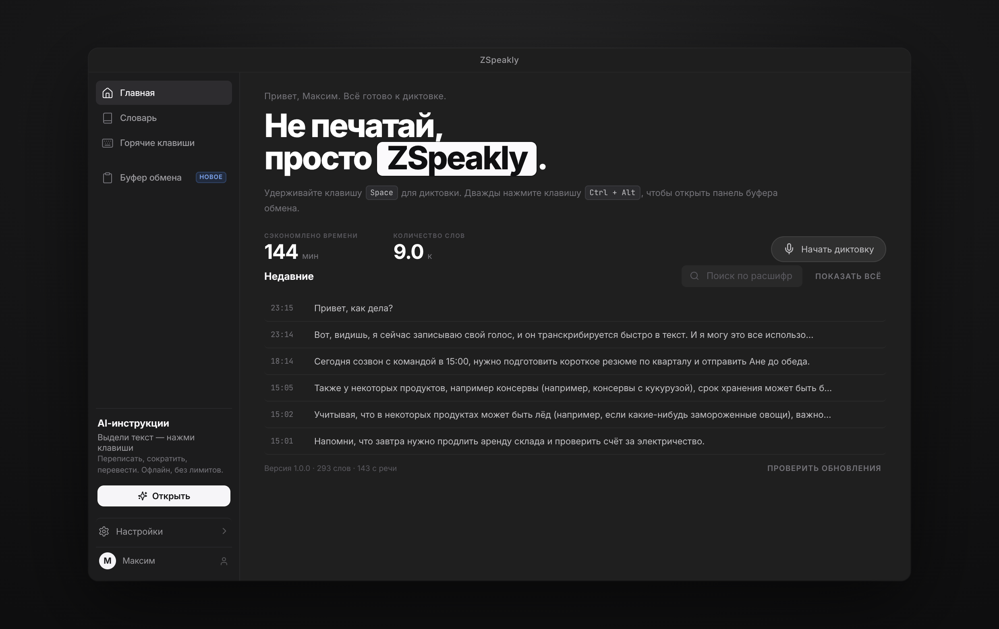

---

## Что уже работает

| Раздел | Что умеет |
|---|---|
| **Главная** | Приветствие по имени, слоган «Не печатай, просто ZSpeakly», счётчики, живая диктовка, история расшифровок с поиском, копирование и **правка с обучением словаря** |
| **Словарь** | Добавление слов и произношения, вкладки, применение к распознанному тексту и **автодобавление слов из ваших правок** |
| **Горячие клавиши** | «Голосовые сочетания» (диктовка, режим агента, свободные руки, диктовка с учётом экрана), «Рекомендуемые» AI-пресеты, «Мои» инструкции, запись любого сочетания, кнопка «Попробовать» и **настоящие глобальные хоткеи над выделенным текстом** |
| **Буфер обмена** | Сетка и список, вкладки, поиск, превью, закрепление; **источник «приложение — окно»** и настоящий **скриншот экрана** по кнопке (в приложении — через main, в превью — через выбор окна браузером) |
| **Настройки** | Профиль (только имя), Приложение (тест микрофона, предпросмотр голосом), Функции, Данные, Сеть, **Диагностика**, О программе |

Плюс: приветствие при первом запуске (имя, без регистрации), тосты, глобальные хоткеи и трей
в Electron-сборке.

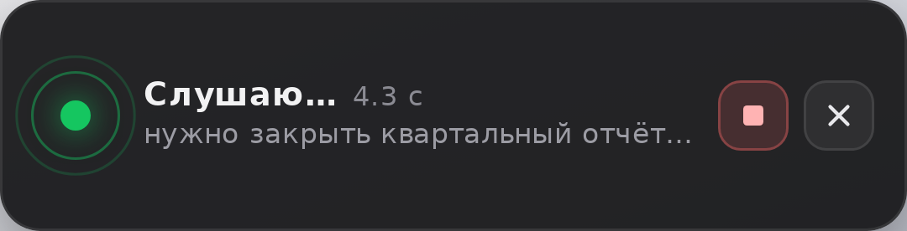

**Индикатор диктовки — отдельное окно поверх всех приложений.** Пока вы диктуете в браузере, почте
или мессенджере, внизу экрана видна плашка: пульс уровня микрофона, таймер и живой текст. На ней две
кнопки — «Остановить запись» (квадрат) и «Скрыть индикатор» (крестик). Окно не забирает фокус,
поэтому текст вставляется туда, где вы печатали. Если плашку скрыть, индикатор переезжает внутрь
окна ZSpeakly — запись не остаётся без управления.

**Свежая установка начинается пустой:** ни чужих расшифровок, ни демонстрационного буфера и словаря —
только ваши данные. Демо-набор остался в тестах и на скриншотах.

**Ничего декоративного.** Каждый тумблер в настройках что-то делает: срок хранения реально удаляет
старые диктовки и записи буфера, «Звуковой отклик» звучит, «Эффект печати» проявляет текст по словам,
«Скрывать пароли» маскирует значения, «Тема → как в системе» переключает палитру, «Автозапуск»
прописывается в систему, «Свернуть в трей» передаётся главному процессу, горячие клавиши AI-инструкций работают в любом
приложении, а не только пока открыт раздел. Статус моделей Whisper
обновляется сам после каждой загрузки — нажимать «Обновить» не нужно, а обновления приложения
скачиваются в фоне и предлагают «Перезапустить» прямо в тосте.

### Резервная копия: один JSON-файл

Раздел **Настройки → Данные и разрешения → Резервная копия**. «Скачать» собирает в один файл
словарь, свои инструкции, AI-инструкции, сочетания клавиш, настройки, профиль и историю диктовок;
«Выбрать файл» возвращает их обратно — с подтверждением и датой копии в диалоге.
Буфер обмена в копию намеренно не попадает: там бывают пароли и коды. Работает и в браузере,
и в установленной версии — файл скачивается обычной загрузкой.

### Диагностика: ошибки видны, личные данные — нет

**Ничего настраивать не нужно.** Журнал пишется на этом компьютере, а если что-то не работает —
одна кнопка «Сохранить отчёт в файл» кладёт на Рабочий стол текстовый отчёт, который достаточно
приложить к сообщению (в браузерном превью тот же отчёт скачивается в папку загрузок). Ни аккаунтов, ни серверов, ни регистрации.

Раздел **Настройки → Диагностика**:

- журнал пишется локально в `%APPDATA%\ZSpeakly\logs\zspeakly.log` — без него не обойтись при разборе;
- **по умолчанию наружу не уходит ничего**: журнал остаётся на компьютере, отправка на сервер
  выключена до тех пор, пока вы сами не впишете адрес;
- уходят только уровень, область (`stt`, `dictation`, `renderer`), текст ошибки, стек, версия
  приложения, платформа и состояние движка распознавания;
- **никогда** не уходят: распознанный текст, буфер обмена, аудио, выделенный текст, промпты, словарь,
  почта и домашние пути (они заменяются на `<email>`/`<home>` ещё до записи и повторно на приёмнике);
- `installId` — случайный uuid, генерируется на устройстве и не связан ни с именем, ни с аккаунтом;
- в интерфейсе видно, что именно накопилось: список последних событий и кнопки
  «Сохранить отчёт в файл», «Скопировать ошибки», «Открыть папку с логами», «Очистить журнал».

**По умолчанию отправки нет вообще** — приложение не требует ни сервера, ни аккаунта. Для тех,
кому нужен приёмник (свой сервер, сбор команды), в `server/` лежит готовый Cloudflare Worker:
`npx wrangler deploy`, хранилище внутри (Durable Object + SQLite), чтение журналов на `/admin`.
Адрес вписывается в «Диагностике» и переживает перезапуск; пустое поле = ничего не отправлять.

### Что намеренно убрано

Автор видео сказал это вслух прямо: «эта вкладка не нужна», «это всё чисто для меня», «всё должно быть
максимально бесплатно». Поэтому в ZSpeakly нет:

- **заметок встреч** и **живого перевода** — это отдельные вкладки, которые он просил не переносить;
- блока **«Пригласить друзей»**, тарифа **Free 0/4000 слов**, кнопки **«Обновить»** и **credits**;
- **QR-модалки «ZSpeakly на вашем телефоне»** — приложение только для его ПК;
- полей **почты** и «подписки» в профиле — остаётся одно имя для приветствия.

### Скриншоты

Сняты с работающего интерфейса: `npm run dev` в одном терминале, затем `npm run screenshots`
(скрипт `scripts/capture-screenshots.mjs`, headless Chromium, окно 1280×800, ретина ×2).
Онбординг пропускается сидом `localStorage`, поэтому кадры детерминированы.

| | |
|---|---|
| 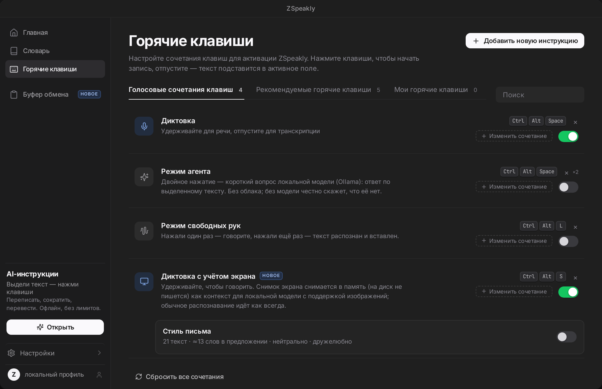 | 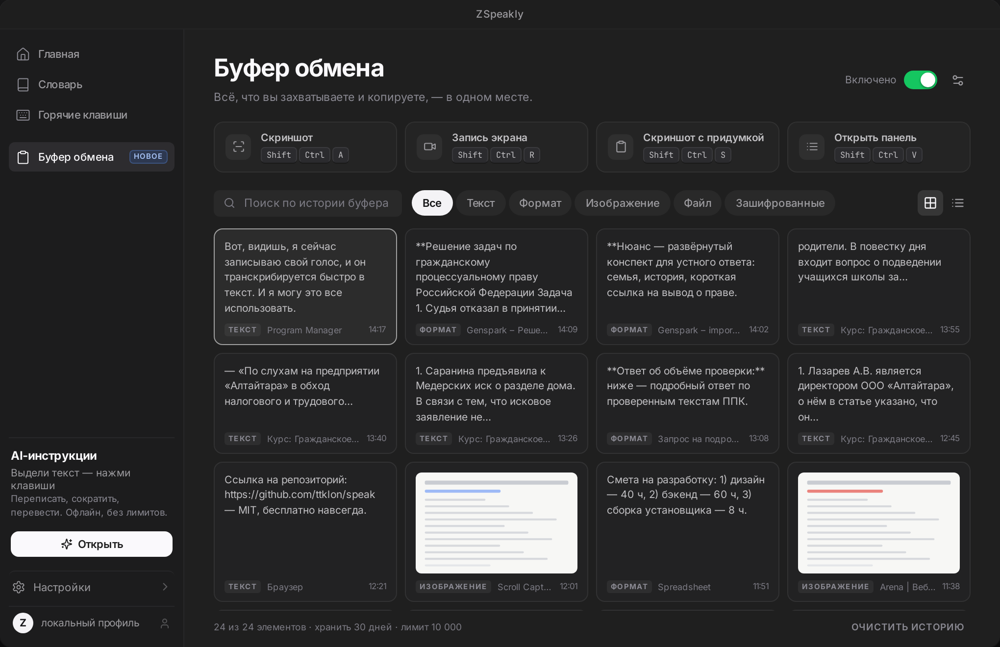 |
| 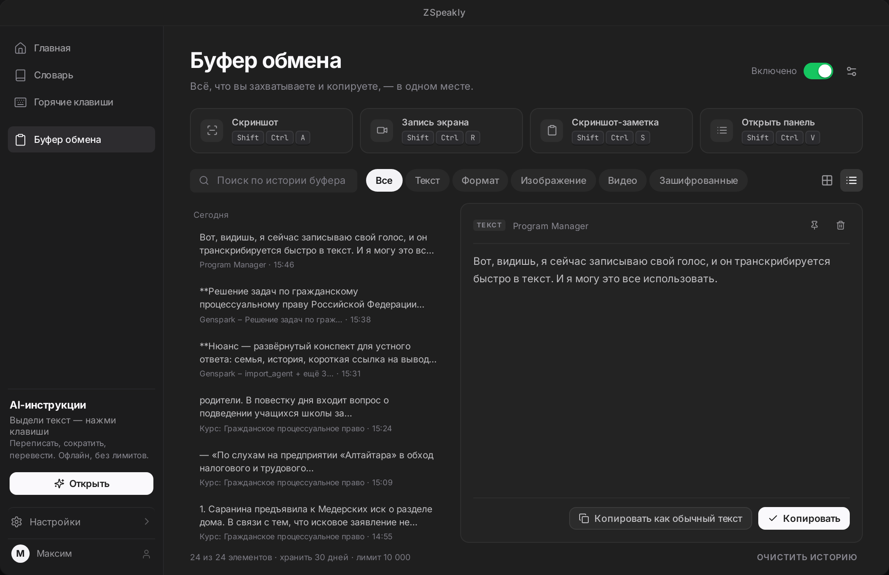 | 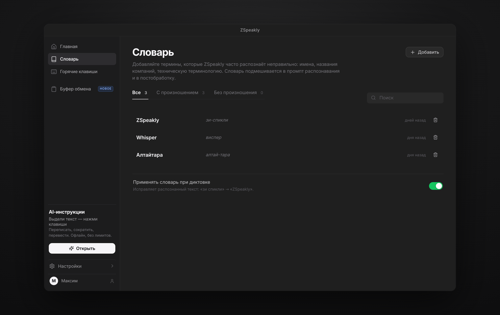 |
| 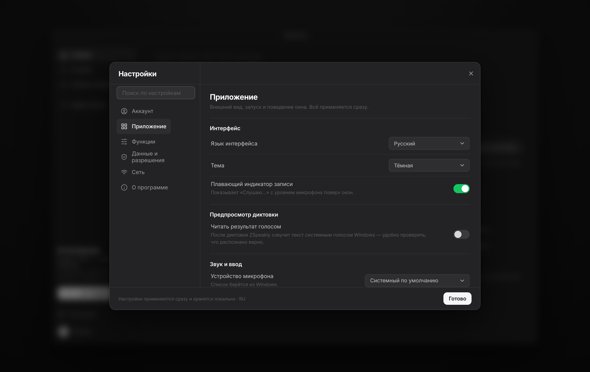 | 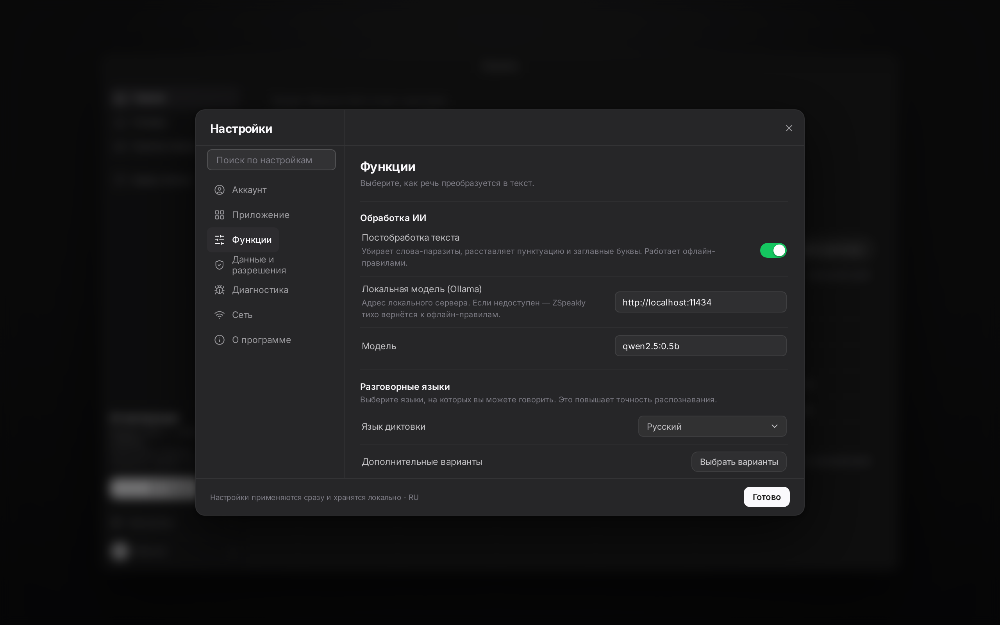 |
| 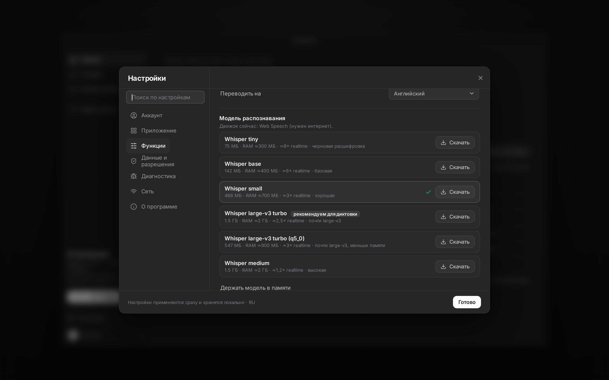 | 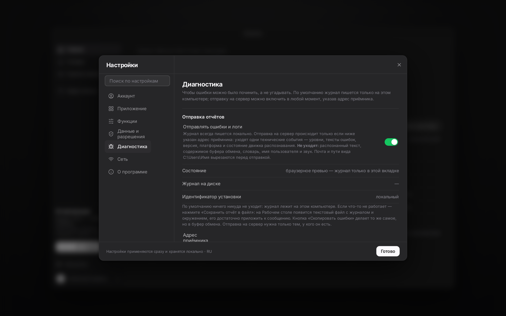 |
|  | 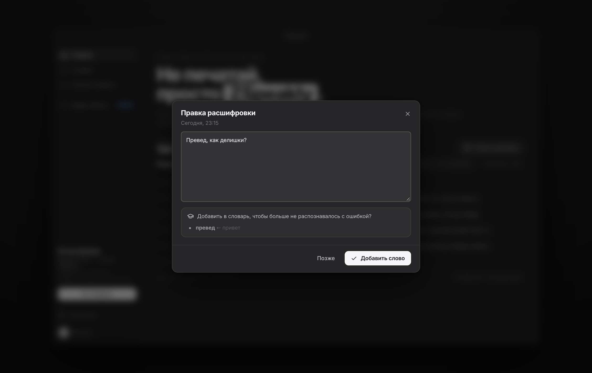 |

Светлая тема — это не фильтр поверх тёмной: палитра переключается токенами (`--text`, `--bg-elevated`,
`--overlay-rgb`), поэтому контраст сохраняется во всех окнах, включая модалки.

| | |
|---|---|
| 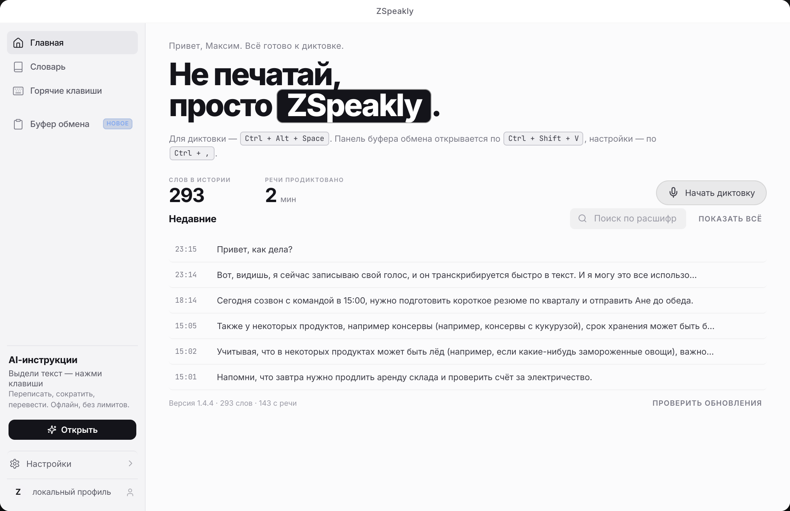 | 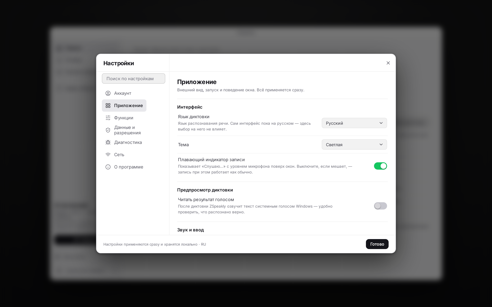 |
| 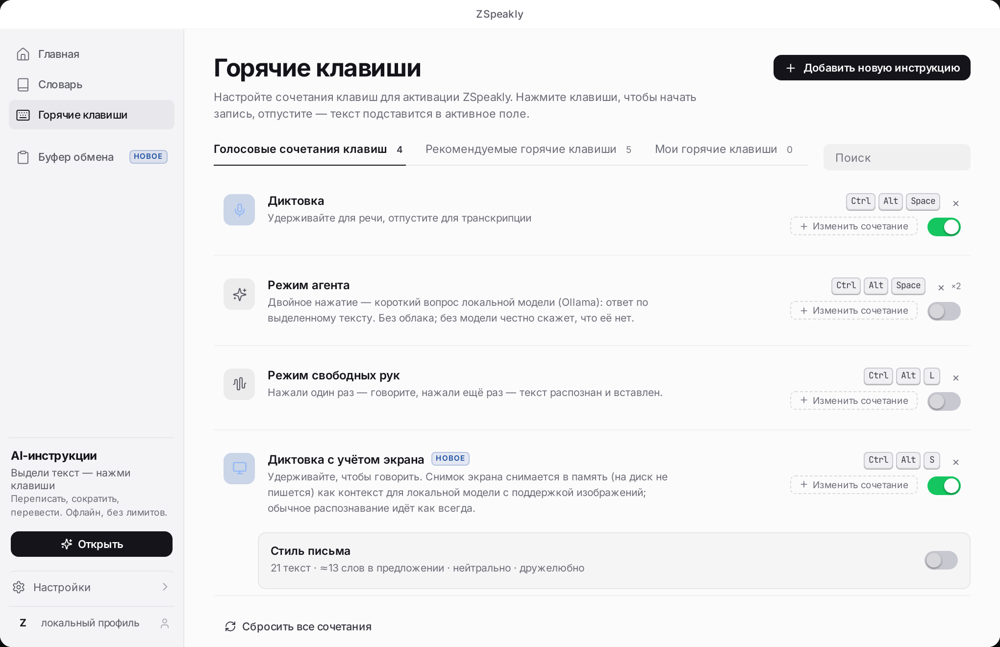 | 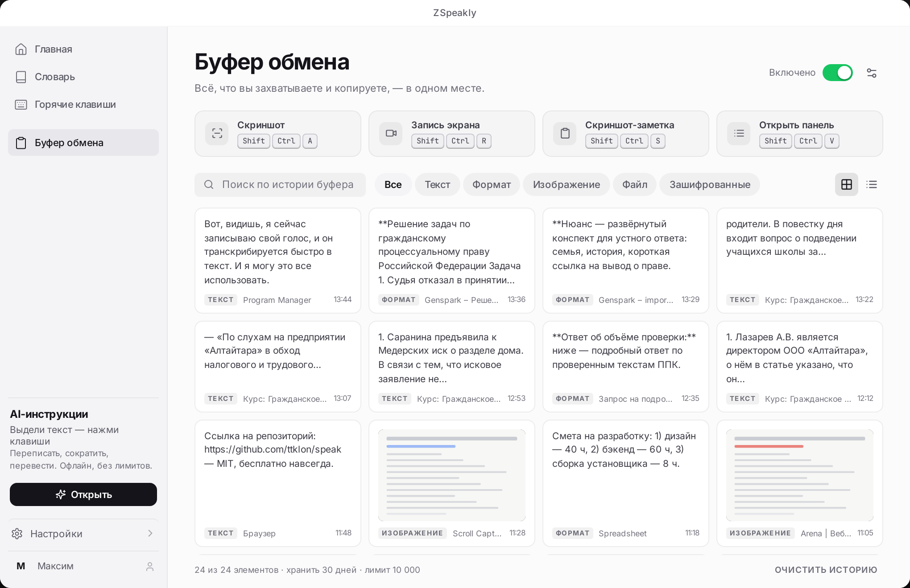 |
| 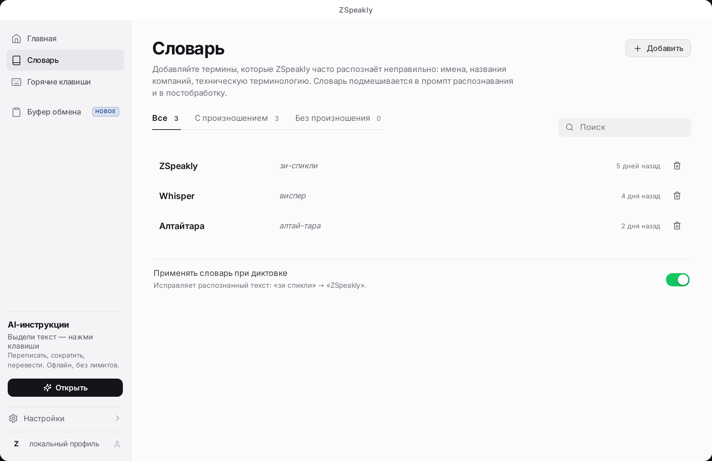 | |

## Стек

- **Electron 33** — десктопная оболочка Windows (безрамочное окно, трей, глобальные хоткеи, буфер);
- **React 18 + Vite 5** — рендерер, MVVM-подобное состояние на контекстах;
- **Inter / JetBrains Mono** — типографика из видео (локально, без CDN);
- **lucide-react** — иконки (MIT), без внешних CDN;
- **Vitest** — 95 тестов: текстовые движки, стиль письма, склонения, буфер, экранный контекст,
  бэкофф локальной модели, рендер всех страниц;
- **Смоук main-процесса** — `npm run test:main` (55 проверок) запускает настоящий `main.cjs` с
  заглушкой Electron: IPC, хоткеи, вставка Ctrl+V в чужое окно, WAV для whisper, картинки в буфере;
- **Проверка IPC-контракта** — `npm run check:ipc`: каждый канал, который зовёт рендерер, обязан
  иметь обработчик (иначе вызов молча зависал);
- **Проверка каналов обновлений** — `npm run test:updater`: бета-канал действительно включает
  предрелизы, а не просто сохраняется в настройках.

> **Python не используется нигде.** Ни в сборке, ни в рантайме: нет `python.exe`, PyInstaller, моста
> через сокеты и питон-зависимостей. Приложение целиком на Electron + Node.js; единственный внешний
> процесс — `whisper-cli.exe` (C++ из whisper.cpp), а сеть — только у Ollama, если её включить.

Сеть используется только там, где вы этого ждёте: локальная модель (Ollama) по желанию, проверка
обновлений на GitHub и отправка служебных журналов — последняя выключается тумблером
«Настройки → Диагностика». Всё остальное — офлайн; без модели и без сети операции деградируют
в офлайн-правила, а не ломаются.

## Быстрый старт (Windows 11)

```powershell
# 1. Node.js 20+ и Git
winget install OpenJS.NodeJS.LTS Git.Git

# 2. Клонировать и установить
git clone https://github.com/ttklon/speak.git C:\dev\speak
cd C:\dev\speak
npm install

# 3. Запустить в дев-режиме (Vite + Electron)
npm run electron:dev
```

Только интерфейс в браузере: `npm run dev` → <http://localhost:5173>.

## Сборка установщика

```powershell
npm run dist:win
# release\ZSpeakly-Setup-1.4.5.exe      — NSIS-установщик
# release\ZSpeakly-1.4.5-portable.exe   — портативная версия
```

Готовые сборки не нужно собирать самому: они лежат в
[Releases](https://github.com/ttklon/speak/releases). CI (GitHub Actions) собирает `.exe` на каждый
тег и публикует их вместе с `latest.yml`, по которому работает автообновление.

Скрипт `npm run icons` перегенерирует `icons/icon.ico` и PNG-набор без внешних зависимостей.

## Что делать после установки

Установщик не тянет за собой 500 МБ моделей — их нужно скачать один раз из самого приложения:

1. Запустите `ZSpeakly-Setup-*.exe` (или распакуйте portable-версию и запустите `ZSpeakly.exe`).
2. «Настройки» (`Ctrl + ,`) → **Функции** → **Модель распознавания**.
3. Нажмите **«Скачать движок whisper.cpp»** (≈20 МБ), затем **«Скачать»** у модели.
   Для диктовки лучшее соотношение скорости и точности — `large-v3-turbo` (1.5 ГБ): это тот же
   large-v3 с укороченным декодером, втрое быстрее при почти том же качестве. Мало памяти —
   берите `large-v3-turbo-q5_0` (547 МБ) или `small` (466 МБ); совсем слабый ноутбук — `base`
   (142 МБ) или `tiny` (75 МБ).
4. Вернитесь на главную и нажмите `Ctrl + Alt + Space` — говорите, отпускайте, текст вставится
   в активное окно.

Пока движка нет, приложение честно скажет об этом в плашке записи. В браузерном превью работает
Web Speech (нужен Chrome и интернет), а если и его нет — понятная ошибка с подсказкой. Выдуманного
текста нет нигде: раньше превью «работало» на демо-движке и печатало заготовленные фразы.

## Как устроено распознавание

ZSpeakly пытается запустить движки по приоритету и честно показывает, какой работает:

1. **whisper.cpp (офлайн, лучший вариант).** Main-процесс ищет `whisper-cli.exe` в
   `resources/bin`, `%APPDATA%\ZSpeakly\bin` и `PATH`; модель `ggml-*.bin` — в `models/`.
   Если оба на месте — диктовка идёт полностью локально, без сети и без браузерных сервисов.
2. **Web Speech API** — черновик в Electron и браузере (нужен интернет и Chrome).
3. Если недоступно ни то, ни другое — честная ошибка с подсказкой, что именно скачать.

Если в комплекте есть `whisper-server`, включите «Держать модель в памяти» (Настройки → Функции):
модель загружается один раз, и диктовка начинается без холодного старта.

Тишину в микрофон приложение не отправляет в whisper (он на пустом звуке выдумывает «Спасибо за
просмотр»), а типовые фразы-галлюцинации отбрасывает. Записи короче 0,3 с и без речи дают понятное
сообщение «В записи нет речи» вместо пустого результата.

Скачать движок и модели одной командой (кладёт всё в `%APPDATA%\ZSpeakly\bin` и `models`):

```powershell
powershell -ExecutionPolicy Bypass -File scripts\download-models.ps1
```

Проверить, что приложение их видит: «Настройки → О программе → whisper.cpp» должно показать
`готов · ggml-small.bin`.

Подробнее: [docs/MODELS-LIGHTWEIGHT.md](docs/MODELS-LIGHTWEIGHT.md),
[docs/06-ARCHITECTURE-NET.md](docs/06-ARCHITECTURE-NET.md) (альтернативная .NET-архитектура).

## Горячие клавиши

| Действие | Сочетание |
|---|---|
| Диктовка (старт/стоп) | `Ctrl + Alt + Space` (в браузере-превью — `Alt + D`) |
| Поиск по буферу | `Ctrl + K` |
| Настройки | `Ctrl + ,` |
| Буфер обмена | `Ctrl + Shift + V` |
| Перевести выделенное | `Ctrl + Alt + E` |
| Сделать формально | `Ctrl + Alt + F` |
| Сократить | `Ctrl + Alt + S` |
| Режим поиска | `Ctrl + Alt + Q` |
| Понизить термины | `Ctrl + Alt + T` |

## Приватность

- Всё хранится локально: `%APPDATA%\ZSpeakly\profile.json` (Electron) или localStorage (браузер).
- Аудио и тексты не отправляются в сеть. Телеметрии нет.
- Словарь и постобработка работают без интернета.

## Разработка

```bash
npm run dev        # только UI
npm run electron:dev
npm test                    # vitest: 112 тестов
npm run test:main           # смоук IPC, whisper --prompt, HTTP к Ollama, снимок экрана, мониторинг буфера (55 проверок)
npm run test:ui             # E2E «нажать всё» в Chromium: кнопки, поля, сценарии, контраст, доступные имена
npm run test:updater        # каналы обновлений (stable/beta)
npm run check:ipc           # нет каналов без обработчика
npm run settings:index      # пересобрать индекс поиска по настройкам
npm run settings:index:check  # проверить, что индекс актуален (это делает CI)
npm run build               # production-сборка рендерера
```

Структура:

```
electron/          main.cjs, preload.cjs, store.cjs, whisper.cjs
src/
  components/      layout, ui, modals, settings/sections
  pages/           Home, Dictionary, Hotkeys, Clipboard
  state/           AppDataProvider, DictationProvider, ToastProvider
  lib/             config, utils, storage, router, translate, ai/textops,
                   ai/instructions, dictionary/learn, hotkeys/useTextAction, recognition
  styles/          base, layout, components, pages, extra
docs/              теардаун видео, план, архитектура
scripts/           иконки, dev-запуск, модели, CI-хелперы
```

## Документация

| Документ | Что внутри |
|---|---|
| [00-VIDEO-TEARDOWN.md](docs/00-VIDEO-TEARDOWN.md) | Покадровый разбор 409 кадров → 32 состояния, размеры, палитра |
| [08-AUDIO-TRANSCRIPT.md](docs/08-AUDIO-TRANSCRIPT.md) | Расшифровка речи автора + таблица «что из этого сделано» |
| [01-MASTER-PLAN.md](docs/01-MASTER-PLAN.md) | План из 12 стадий / 85 шагов |
| [06-ARCHITECTURE-NET.md](docs/06-ARCHITECTURE-NET.md) | Альтернативная .NET-архитектура (WPF + Whisper.NET) |
| [MODELS-LIGHTWEIGHT.md](docs/MODELS-LIGHTWEIGHT.md) | Лёгкие модели: размеры, RAM, скорость |
| [09-CODE-MAP.md](docs/09-CODE-MAP.md) | Карта программы: слои, файлы, потоки диктовки и инструкций, IPC, хранение, ограничения |
| [10-HOW-DICTATION-APPS-WORK.md](docs/10-HOW-DICTATION-APPS-WORK.md) | Как устроены Wispr Flow, superwhisper, Svara и Phonon: модели, VAD, чистка текста, вставка — и что из этого есть в ZSpeakly |

## Лицензия

MIT — делай что хочешь, бесплатно навсегда.
